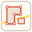

# Yandex Buildings Extractor (QGIS plugin)

**EN.** Extracts building footprints from Yandex Maps tiles. Draw an area on
the map, and the plugin downloads tiles, detects buildings by fill color,
vectorizes them and adds each building type (residential, non-residential,
public, educational, medical, cultural, or your own categories) to the project
as a separate GeoJSON layer in EPSG:3395.

**RU.** Извлекает контуры зданий с карты Яндекса. Нарисуйте область на карте —
расширение скачает тайлы, выделит здания по цвету заливки, векторизует их и
добавит каждый тип зданий (жилые, нежилые, общественные, учебные,
медицинские, культурные или свои категории) отдельным слоем GeoJSON в
EPSG:3395.

## Features / Возможности

- Area selection by drawing a rectangle on the map / выбор области рамкой
- Zoom 19–21, filters in meters / зум 19–21, фильтры в метрах
- Custom categories with an eyedropper that reads the exact tile color /
  свои категории с пипеткой по точному цвету тайла
- Label and icon healing, right-angle squaring, fence filtering /
  заращивание подписей, спрямление углов, фильтр заборов
- Background task with progress and cancel / фоновая задача с отменой
- Russian and English interface / интерфейс на русском и английском

## Installation / Установка

From the QGIS plugin repository: *Plugins → Manage and Install Plugins*,
search for **Yandex Buildings Extractor**. Or download a release ZIP and use
*Install from ZIP*.

The plugin requires `opencv-python-headless`; on first launch it offers to
install it automatically. Manual install: open OSGeo4W Shell and run
`pip install opencv-python-headless`.

Detailed notes and version history (RU): [yandex_buildings/README.md](yandex_buildings/README.md).

## License

GNU GPL v2 or later — see [LICENSE](LICENSE).
